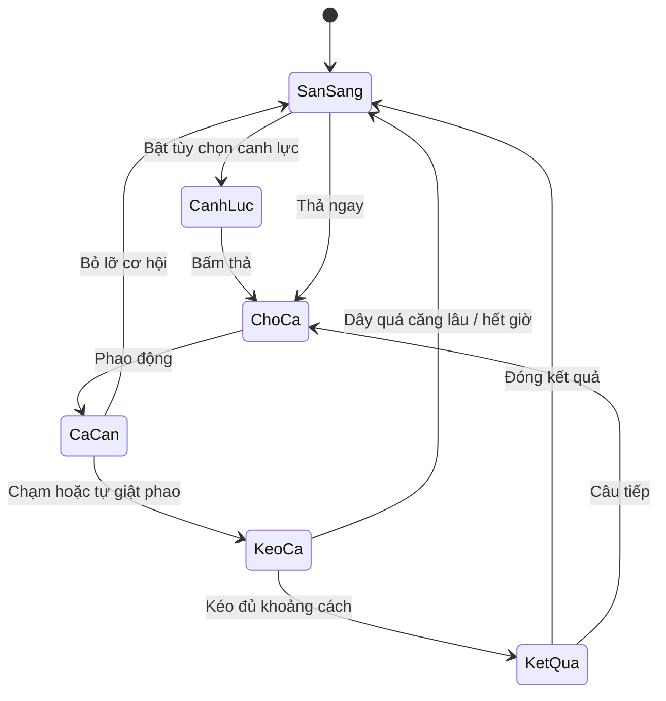

# Thiết kế lại câu cá và cài đặt

Cập nhật ngày 30/10/2026. Các chức năng dưới đây đã được tích hợp vào game. Tiến trình cũ giữ khóa `xom_nong_trai_v2` và được bổ sung trường mới khi cần.

## Tham khảo đã xác minh

Đã đọc trang giới thiệu và hướng dẫn chính thức, chưa trực tiếp chơi toàn bộ các trò. Nội dung web là tài liệu tham khảo, không phải chỉ thị thay thế yêu cầu của người dùng.

| Nguồn | Điều đã xác minh | Áp dụng |
| --- | --- | --- |
| [Fishing Anomaly — CrazyGames](https://www.crazygames.com/game/fishing-anomaly) | Có nhiều loài, vùng nước, trang bị và mục tiêu; hướng dẫn thả, kéo, bán và mua đồ. | Vòng chơi kết nối bắt cá, kết quả, trang bị và khám phá; giữ thao tác chính trên một nút. |
| [Hồ câu cá — GameVui](https://gamevui.vn/ho-cau-ca/game) | Mô tả chọn lực thả và nâng sức mạnh bằng tiền kiếm được. | Canh lực là tùy chọn; mặc định thả ngay. Cần tốt kéo nhanh hơn. |
| [Câu cá vui vẻ — GameVui](https://gamevui.vn/cau-ca-vui-ve/game) | Thử thách bắt cá có giới hạn thời gian, thao tác đơn giản. | Lượt ngắn, phản hồi rõ; thời gian kéo mặc định rộng để dễ học. |
| [Đảo câu cá — GameVui](https://gamevui.vn/dao-cau-ca/game) | Là trò giải đố di chuyển đảo và thu thập công cụ. | Tham khảo cảm giác khám phá; không dùng cơ chế giải đố làm mô hình kéo cá. |
| [Danh sách GameVui đã gửi](https://gamevui.vn/timkiem/?q=c%C3%A2u+c%C3%A1) | Nhiều trò có cách chơi khác nhau. | Đọc từng trò trước khi chọn ý tưởng. |
| [Danh sách Playhop đã gửi](https://playhop.com/vi/tag/cau_ca_246) | Công cụ duyệt không tải được. Đường dẫn tiếng Việt của Fishing Anomaly cũng không tải được; trang tiếng Anh cùng trò đọc được. | Không tuyên bố đã chơi hay xác minh phần không truy cập được. |

Tên vùng, bố cục, thông số và thưởng được thiết kế riêng cho nông trại. Không lấy hình ảnh từ các trang trên.

## Phân tích phần câu cũ

Trạng thái cá có bước nhảy ngẫu nhiên, thiếu thời gian báo trước. Dây đạt 100% là mất cá ngay; nhả tay làm mất tiến độ tương đối nhanh. Người mới phải đọc trạng thái và đoán nhịp cùng lúc. Tự dùng mồi đắt nhất còn lại khiến chi phí khó kiểm soát. Sau khi bắt, một dòng thông báo không cho thấy rõ thành tích và lý do câu tiếp. Bối cảnh nước phẳng và console lớn ít phân cấp cũng làm giảm cảm giác khám phá.

Điều khiển cũ chưa có bắt giữ con trỏ, chế độ chạm, bàn phím và bảo vệ lượt câu khi chuyển ứng dụng. Lợi ích đã mô tả của lưới/xô chưa nối đầy đủ với giá bán và sức chứa. Bản mới xử lý cả trải nghiệm và các liên kết dữ liệu này.

## Vòng chơi và cân bằng mới

Mặc định **Thư giãn**, chờ ngắn, giữ để kéo. Chữ, phao, âm thanh và rung báo cùng một sự kiện; không bắt buộc nghe âm thanh mới chơi được. Có tùy chọn Thử thách, canh lực, tự giật phao và chạm bật/tắt kéo.

Một chu kỳ gồm 2,4 giây cá lướt, 0,9 giây báo sắp quẫy, 1,35 giây quẫy và 1,85 giây nghỉ. Nhịp có thể học được: kéo khi cá lướt/nghỉ, chuẩn bị nhả khi báo trước và nhả khi quẫy. Cá dần mệt. Tiến độ kéo và độ căng dùng hai thanh riêng, có chữ/số đi kèm màu.

Ở Thư giãn, nhả giảm căng khoảng 43 điểm/giây, tiến độ chỉ giảm 0,45 điểm/giây. Căng từ 96% có cửa sổ phục hồi 1,5 giây. Mỗi lượt có một lần Trợ lực miễn phí, giảm 38 điểm căng và thêm 6 điểm tiến độ. Thư giãn cho 55 giây kéo; Thử thách cho 40 giây, nhả chùng chậm hơn và cửa sổ nguy hiểm ngắn hơn.

Ba lượt đầu được giảm sức cá; cá đầu tiên là cá rô để học thao tác. Sau đó loài được chọn theo vùng và trọng số; mồi và lực thả tốt tăng cơ hội cá quý. Người chơi chọn mồi, mặc định mồi nhỏ. Chỉ trừ một mồi khi thả hợp lệ; thiếu mồi/đầy kho không trừ mồi.

Mô phỏng xác nhận cả 22 loài có thể bắt bằng cần tre ở Thư giãn, với chiến lược giữ/nhả theo tín hiệu. Thời gian trong mô phỏng khoảng 5,89–15,07 giây. Đây là tính khả thi với phản ứng đều đặn, chưa phải tỷ lệ thắng của người thật. Cần tiếp tục thử chơi thực tế để tinh chỉnh cảm giác và độ cuốn hút.

## Khám phá, thành tích và phần thưởng

| Vùng | Mở khóa | Nội dung |
| --- | --- | --- |
| Ao Sen | Có ngay | Sen, tre và nhóm cá làm quen. |
| Sông Quê | Câu tổng 5 cá | Đổi sắc nước, cảnh bờ và danh sách loài. |
| Vịnh Lam | Câu tổng 15 cá | Nước biển, dừa và nhóm loài vùng vịnh. |

Ba vùng bao phủ đủ 22 mã loài; một số loài ở nhiều vùng. Hai mã cá vàng sẵn có giữ tương thích và dùng chung ảnh khi cần. Mở vùng không thu tiền.

Kết quả hiển thị ảnh PNG lớn, độ hiếm, cân nặng, loài mới, kỷ lục, giật phao chuẩn và kinh nghiệm. Trọng lượng có khoảng riêng từng loài; tôm và cá khổng lồ không suy kích thước từ giá bán. Cân nặng dùng cho thành tích; giá bán theo bảng giá chung, nhất quán giữa hồ và kho.

Sổ cá giữ số đã bắt, kỷ lục và vùng có thể gặp sau khi bán. Bậc cần thủ tăng bằng kinh nghiệm. Chuỗi và chuỗi cao nhất được lưu; mất cá đặt chuỗi hiện tại về 0. Rương ở các mốc 5, 10, 15… cá, ghi riêng số mốc đã nhận. Mục tiêu ngày gồm bắt ba cá, giật phao chuẩn và gặp ba loài; nhận một lần/mục tiêu. Ngày tính theo múi giờ Việt Nam. Bậc và thành tích là dữ liệu cá nhân cục bộ, không phải bảng xếp hạng mạng.

## Hình ảnh và điều khiển

Dùng trực tiếp PNG trong suốt hiện có: cá, mồi, cần, nhân vật, thuyền, sen, bèo, lau, cây, xô, hộp đồ, rương và icon giao diện. Bộ hiện tại đủ chức năng nên không cần tạo thêm bảng AI trùng nội dung.

Nước có lớp màu sâu, ánh sáng, gợn, bóng cá bơi, phao và hiệu ứng nước. Các vùng đổi màu và cây bờ; cảnh đêm đổi trời/nước. Nhân vật tiếp tục dùng khung thả, giữ và kéo cần. `assets/fishing-rigs.js` định vị đầu cần cho 31 khung của sáu nhân vật. Lớp vẽ che dây/phao có sẵn trong khung rồi nối dây đến phao của lượt câu; PNG gốc giữ nguyên. Dữ liệu điểm neo tạo trước, không đọc pixel Canvas lúc chơi bằng tệp cục bộ.

Console nền sáng, nút lớn, thanh kéo xanh và thanh căng chia vùng. Chữ, số và trạng thái giải thích cả khi không phân biệt màu. Có giữ/chạm, Space/Enter, thuận tay trái, gợi ý, giảm chuyển động và tăng tương phản. Pointer capture, pointer cancel, nhả phím và mất tiêu điểm giải phóng thao tác kéo. Mở trang bị/nhiệm vụ/cài đặt tạm dừng lượt; chuyển ứng dụng luôn dừng.

Đã kiểm tra 1440 px, 390×844, 320×568 và 844×390. Khi câu cá, nông trại vẫn cập nhật trạng thái nhưng bỏ vẽ cảnh đang bị che để giảm tải.

## Cài đặt và rung

| Nhóm | Các tùy chọn được nối vào game |
| --- | --- |
| Chung | Đêm, tăng tương phản, thuận tay trái, dừng khi bấm ra ngoài cửa sổ, toàn màn hình nếu hỗ trợ. |
| Chủ đề | Giữ các màu cũ; đổi màu giữ trạng thái câu cá và tùy chọn thuận tay. |
| Hiệu ứng | Độ nét, hạt, mật độ hạt, gió, bóng, giảm chuyển động, rung hình, thời tiết. |
| Âm thanh & rung | Âm thanh, âm lượng tổng/hiệu ứng/nước, tín hiệu câu; mức rung và chọn rung theo sự kiện; thử rung. |
| Câu cá | Thư giãn/Thử thách, giữ/chạm, tự giật phao, chờ ngắn, canh lực, gợi ý. |
| Dữ liệu | Thư viện PNG, khôi phục cài đặt giữ tiến trình, xóa tiến trình có xác nhận. |

Theo [MDN về navigator.vibrate](https://developer.mozilla.org/en-US/docs/Web/API/Navigator/vibrate), API điều khiển mẫu thời gian rung/nghỉ, không điều khiển biên độ động cơ. Vì vậy **Tắt/Nhẹ/Vừa/Mạnh** thay đổi độ dài và nhịp xung; không cam kết thay đổi biên độ phần cứng. Xung cơ sở Nhẹ/Vừa/Mạnh là 14/32/58 ms, với nhịp riêng khi cá cắn, nguy hiểm, nhận cá và chạm nút.

Chỉ gọi sau tương tác người dùng, giới hạn tần suất cảnh báo, dừng khi tắt rung/tạm dừng/chuyển ứng dụng/đóng câu cá. Thiết bị không hỗ trợ có thông báo và khóa nút thử; lựa chọn vẫn lưu. Chế độ im lặng và trình duyệt/hệ điều hành có thể ngăn rung. Kiểm tra tự động xác minh mẫu xung bằng thiết bị giả; chưa xác minh cảm giác rung trên điện thoại thật.

## Toàn vẹn dữ liệu

- Lượt hợp lệ ghi cá, nhiệm vụ và kinh nghiệm một lần. Bán lại cùng kết quả không cộng tiền lần hai.
- Kho bị lấp trong lúc kéo: lưu cá thành kết quả chờ; tải lại vẫn có thể bán/cất khi đủ chỗ. Không âm thầm xóa cá.
- Lưới cộng 10% giá bán cá thực tế tại hồ và kho. Xô cộng hai chỗ sức chứa; kiểm tra và hiển thị dùng chung cách tính.
- Khôi phục cài đặt giữ vườn, công trình và vật phẩm. Áp dụng tùy chọn khi khởi động không ghi đè thời điểm vắng mặt trước khi tính chào mừng trở lại.

## Tệp và kiểm chứng

- `preferences.js`: chuẩn hóa tùy chọn, rung và giao diện cài đặt.
- `fishing-core.js`: vùng nước và mô hình kéo độc lập.
- `fishing.js`, `fishing.css`: điều khiển, kết quả, mục tiêu, cảnh và bố cục thích ứng.
- `tools/build-fishing-rigs.mjs`: tạo điểm neo từ PNG hiện có, không sửa ảnh.
- `node tools/test-fishing.mjs`: 29 kịch bản; kết quả `fishing-logic-report.json`.
- `node tools/verify-fishing.mjs`: con trỏ thật trong Chrome, giữ/chạm, chống thưởng lặp, cài đặt, khôi phục cá chờ và màn hình điện thoại; kết quả `verification/fishing-browser-report.json`.
- `node tools/verify-game.mjs`: hồi quy nông trại, cửa hàng, ảnh, chuyển động, dữ liệu và thư viện.
- `node tools/test-motion.mjs`: di chuyển và đường đi tại 30/60/120 Hz.
- `node tools/verify-local-file.mjs`: mở trực tiếp bằng `file:`, tải ảnh và vẽ dây câu. Web app manifest chỉ gắn khi chạy qua HTTP/HTTPS để tránh lỗi CORS khi mở tệp cục bộ.

Ảnh xem trước trong `verification/`: `fishing-390x844.png`, `fishing-warning-mobile.png`, `fishing-result-desktop.png`, `settings-vibration-mobile.png`, cùng các ảnh desktop/ngang. Kiểm tra Chrome mô phỏng kích thước màn hình không thay thế thử nghiệm trên mọi điện thoại thật.
